  
  
  

  

Free · no account · no telemetry · updates itself

PULSE gives Windows a panel of buttons and global shortcuts that open your apps and sites, run whole routines in one click, arrange windows and control OBS.

<table>
  <tr>
    <td width="50%"></td>
    <td width="50%"></td>
  </tr>
  <tr>
    <td width="50%"></td>
    <td width="50%"></td>
  </tr>
</table>

### ◆ What's inside

| | |
| --- | --- |
| 🎛️ **Buttons** | Pages of buttons for every situation. Each one opens an app, a site or a Chrome profile, presses keys or runs a workflow. Pin favorites to Home. |
| 🔁 **Workflows** | Open apps and sites, wait, press keys, switch OBS scenes, all in one click. Live progress and a check before every run. |
| ⌨️ **Global shortcuts** | Run any button or workflow from any app, even with PULSE in the tray. |
| 🔎 **Command palette** | `Ctrl+K` inside PULSE, `Alt+Shift+Space` anywhere. Type and run. |
| 🪟 **Window layouts** | Put real app windows into a saved arrangement on a monitor. |
| 📡 **Streaming** | Start and end your whole stream setup. PULSE closes only what it opened. |
| 🛡️ **Safe by design** | No scripts or shell, nothing closes without asking, Windows-critical processes are never touched. |
| 🧠 **Adaptive** | PULSE checks this PC and offers only what works here. A 5-step tour gets you to your first button in a minute. |
| 🌍 **Yours** | English, Українська, Polski, Русский. Six themes, or follow Windows light/dark mode. |

### ◆ Install

1. Download **`PULSE-Setup-<version>.exe`** from the [latest release](https://github.com/Atall-dev/pulse-releases/releases/latest).
2. Run it. No administrator rights are needed. Your data stays in `%APPDATA%\PULSE`.
3. Done. From now on PULSE updates itself (**Settings → About**).

> [!NOTE]
> **"Windows protected your PC"?** The installer is not code-signed yet, so SmartScreen doesn't know it. Click **More info → Run anyway**. Updates are downloaded only from this repository and verified by SHA-512 before they install.

### ◆ FAQ

<b>Is it really free?</b>

 
Yes. No subscription, no ads, no account. If PULSE saves you time, crypto tips are welcome: the addresses are in <b>Settings → About → Support the author</b>.

<b>What does PULSE send over the internet?</b>

 
Nothing about you. There is no telemetry. The only request PULSE makes on its own is the update check against this repository.

<b>Does it read my Chrome data?</b>

 
Only profile names and pictures from Chrome's local metadata, so it can open the right profile. It never reads emails, cookies, tokens or passwords, and never writes anything into Chrome.

<b>Where is the source code?</b>

 
In a separate private repository. This one hosts the Windows installers and the update feed.

 

Made by <a href="https://github.com/Atall-dev">Atall</a> · ⭐ Star it if PULSE saves you time · 🔔 Watch → Custom → Releases to hear about new versions

